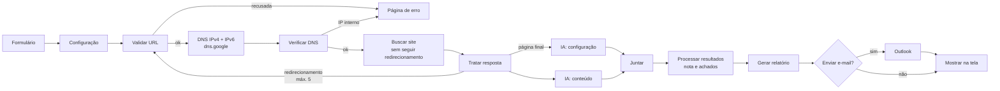

# Scanner de Segurança Web

Fluxo do **n8n** que analisa a segurança de um site a partir de um formulário. Você informa o endereço e recebe na tela, e opcionalmente por e-mail (Outlook), um relatório com **nota de A+ a F**, os problemas encontrados e como corrigir cada um.

A análise é **passiva**: o scanner lê a página uma única vez, como um navegador. Ele não testa ataques, não faz força bruta e não varre portas.


## O que é verificado

| Área | Como | Exemplos |
|---|---|---|
| **Cabeçalhos de segurança** | Regras automáticas sobre os cabeçalhos reais | CSP, HSTS, X-Content-Type-Options, proteção contra clickjacking, Referrer-Policy, Permissions-Policy |
| **Cookies** | Regras automáticas | Falta de `Secure`, `HttpOnly`, `SameSite` |
| **Transporte e exposição** | Regras automáticas | Site sem HTTPS, `Server`/`X-Powered-By` com versão, CORS `*` |
| **Configuração (IA)** | Google Gemini analisa os cabeçalhos | Explicação do risco e exemplos de correção para nginx e Apache |
| **Conteúdo da página (IA)** | Google Gemini analisa o HTML/JS | Chaves expostas, comentários com dados internos, scripts sem SRI, possíveis pontos de XSS |

A **nota vem só das regras automáticas**, aplicadas aos cabeçalhos que o site realmente enviou. A IA pode errar, por isso entra como análise complementar e não altera a nota. Se a IA falhar, por exemplo sem chave ou com a cota esgotada, o relatório sai do mesmo jeito, com um aviso na seção dela.

## Como o fluxo funciona



## Segurança do próprio scanner

Uma ferramenta que acessa qualquer URL digitada pode virar um ataque se não for protegida. Este fluxo nasceu de um modelo da comunidade n8n, e nele foram corrigidos estes pontos:

- **SSRF (Server-Side Request Forgery).** Sem proteção, alguém poderia "analisar" `http://redis:6379`, `http://192.168.0.1` ou `http://169.254.169.254` (metadados de nuvem) e usar o n8n para alcançar a rede interna. O fluxo:
  - aceita só `http`/`https` nas portas 80 e 443, sem usuário ou senha na URL;
  - recusa nomes internos (`localhost`, nomes sem ponto como `n8n`, `.local`, `.internal`...);
  - lê a URL de forma **estrita** e a remonta em formato canônico. Formas ambíguas, como IPv4 em octal, hexa ou decimal (`0177.0.0.1`, `2130706433`), barra invertida e `usuario@`, são recusadas;
  - resolve o domínio (IPv4 e IPv6) e **recusa se qualquer IP for privado, loopback, link-local ou reservado**, o que pega domínios como `127.0.0.1.nip.io`;
  - **não segue redirecionamentos sozinho**: cada novo destino passa de novo pela validação (no máximo 5).
- **Injeção de HTML no relatório.** Cabeçalhos e HTML vêm do site analisado e podem ser maliciosos. Todo texto do site e da IA é **escapado** antes de virar HTML, e links só são criados para `http(s)`. O n8n ainda exibe a página final com uma CSP de sandbox.
- **Prompt injection.** O conteúdo do site vai para a IA delimitado e marcado como dado não confiável, com a instrução de nunca seguir ordens que estejam nele.
- **Limite de tamanho.** Só os primeiros 60 mil caracteres da página vão para a IA (imagens em base64 são removidas), o que evita estourar tokens.
- **Correção de bug.** O modelo original tinha um comentário HTML (`<!-- -->`) no meio do JavaScript, e o nó de relatório falhava sempre.

Limitações conhecidas: entre a checagem de DNS e o acesso existe uma janela pequena (*DNS rebinding*). Para ambientes expostos à internet, ative também a proteção nativa do n8n (`N8N_SSRF_PROTECTION_ENABLED`) e deixe o formulário acessível só para quem deve usar. A consulta de DNS é feita no `dns.google`, então o Google fica sabendo qual domínio foi consultado.

## Requisitos

- **n8n 2.x** (testado no 2.46.4), por exemplo em Docker.
- Chave gratuita do **Google Gemini**: https://aistudio.google.com/apikey (modelo `gemini-flash-latest`, apelido do Google para o Flash mais recente).
- *(Opcional)* Conta Microsoft (Outlook/Hotmail pessoal ou corporativa) e um app registrado no **Entra ID**, para enviar o relatório por e-mail.
- Para desenvolver: Python 3 (gerador do fluxo) e Node.js (testes).

## Instalação

### Opção A: pela tela do n8n

1. No n8n, vá em **Workflows > Import from File** e escolha [workflow/scanner-seguranca-web.json](workflow/scanner-seguranca-web.json).
2. Configure as credenciais (abaixo).
3. Clique em **Publish**.

### Opção B: por script, com n8n em Docker

```bash
bash scripts/importar-fluxo.sh                  # container padrão: ng-soc-automacao-n8n-1
bash scripts/importar-fluxo.sh nome-do-container
```

O script gera o JSON, importa, publica e reinicia o n8n. As credenciais que já existem no n8n, mesmo criadas pela tela, são ligadas aos nós pelo tipo. Ele **substitui** a versão do fluxo que estiver no n8n com o mesmo id (`scannerSegWeb001`).

## Credenciais

### Google Gemini (obrigatória para a parte de IA)

Escolha uma das formas:

- **Pela tela:** em *Credentials*, crie ou abra **Google Gemini (scanner)** (tipo *Google Gemini (PaLM) API*) e cole a chave.
- **Por script:** copie `.env.exemplo` para `.env`, cole a chave em `GEMINI_API_KEY` e rode:
  ```bash
  bash scripts/importar-credenciais.sh
  ```
  O `.env` fica fora do Git (`.gitignore`) e a chave nunca é impressa.

### Outlook (opcional)

1. Em https://entra.microsoft.com, abra **Registros de aplicativo > Novo registro**:
   - **Tipos de conta:** *Qualquer locatário do Entra ID + contas pessoais da Microsoft*;
   - **URI de redirecionamento:** plataforma **Web**, com o endereço que o n8n mostra em *OAuth Redirect URL* (ex.: `http://localhost:5678/rest/oauth2-credential/callback`).
2. Em **Certificados e segredos**, crie um segredo do cliente e copie o **Valor**, que só aparece uma vez.
3. Em **Permissões de API > Microsoft Graph > Permissões delegadas**, adicione só **`Mail.Send`**.
4. No n8n, crie a credencial **Microsoft Outlook OAuth2 API** com o *ID do aplicativo (cliente)* e o segredo. Ligue **Custom Scopes** com `openid offline_access Mail.Send` e clique em **Connect my account**.
5. No nó **Configuração**, mude `enviarEmail` para `true` e preencha `emailDestino`.

> O n8n monta o *OAuth Redirect URL* a partir de `N8N_WEBHOOK_URL`. Se aparecer um nome interno do Docker (ex.: `http://n8n:5678/`), a Microsoft recusa o endereço. Nesse caso, use `N8N_WEBHOOK_URL=http://localhost:5678/`.

O e-mail vai sempre para o endereço fixo da configuração. Assim o formulário não pode ser usado para mandar e-mail a terceiros.

## Uso

Abra o formulário (com n8n local):

```
http://127.0.0.1:5678/form/scanner-seguranca-web
```

Digite o endereço (ex.: `https://seusite.com.br`) e clique em **Analisar site**. Em 10 a 40 segundos o relatório aparece na tela.

Outros ajustes no nó **Configuração**:

| Campo | Padrão | Para que serve |
|---|---|---|
| `enviarEmail` | `false` | Envia também por Outlook |
| `emailDestino` | vazio | Quem recebe o relatório |
| `limiteConteudo` | `60000` | Quantos caracteres do HTML vão para a IA |

## Como a nota é calculada

São 4 itens críticos: **CSP**, **HSTS** (só em HTTPS), **X-Content-Type-Options: nosniff** e **proteção contra clickjacking** (X-Frame-Options ou `frame-ancestors` na CSP). Além deles, há 2 itens importantes: **Referrer-Policy** e **Permissions-Policy**.

| Situação | Nota |
|---|---|
| 4 críticos + 2 importantes | A+ |
| 4 críticos + 1 importante | A- |
| 4 críticos | B+ |
| 3 críticos | B (com 1+ importante) ou C+ |
| 2 críticos | C |
| 1 crítico | D |
| nenhum | F |

Uma CSP com `'unsafe-inline'` (sem nonce ou hash) desce a nota um degrau. **Sem HTTPS, a nota não passa de D.**

## Desenvolvimento

O código de cada nó *Code* fica em [src/](src/), em arquivos `.js` legíveis, e as bibliotecas comuns ficam em [src/lib/](src/lib/). O JSON do fluxo é **gerado** a partir deles:

```bash
node tests/testar-codigo.js      # 87 testes: URLs recusadas, DNS, redirecionamentos, nota, escape do HTML
python scripts/gerar-fluxo.py    # gera workflow/scanner-seguranca-web.json
```

Os testes rodam o mesmo código dos nós e simulam `$input` e `$('Nó')`. Eles também deixam a classe `URL` indefinida, como acontece na sandbox do n8n. A CI ([.github/workflows/ci.yml](.github/workflows/ci.yml)) roda os testes, confere se o JSON está atualizado e procura segredos com o gitleaks.

```
scanner-seguranca-web/
├── src/                     código dos nós Code
│   ├── lib/ip.js            faixas de IP bloqueadas (IPv4 e IPv6)
│   ├── lib/url.js           leitura estrita de URL e redirecionamentos
│   ├── lib/html.js          escape de HTML e Markdown seguro
│   ├── validar-url.js       verificar-dns.js   tratar-resposta.js
│   └── processar-resultados.js   gerar-relatorio.js   pagina-erro.js
├── scripts/                 gerar-fluxo.py, importar-fluxo.sh, ajustar-credenciais.py, importar-credenciais.sh
├── tests/testar-codigo.js
├── workflow/scanner-seguranca-web.json   (gerado; é este que se importa no n8n)
└── docs/exemplo-relatorio.png
```

## Uso ético

Analise apenas **sites seus ou que você tem autorização para avaliar**. Mesmo passiva, a análise de terceiros sem permissão pode violar termos de uso ou leis locais. O relatório é automático e não substitui um teste de intrusão feito por profissional.

## Créditos

Baseado no modelo *Website Security Scanner* da comunidade n8n, reescrito em português. Mudanças em relação ao original: proteção contra SSRF, escape do relatório, Google Gemini no lugar da OpenAI, Outlook no lugar do Gmail, nota calculada pelos cabeçalhos reais, relatório na tela e testes automatizados.

## Licença

[MIT](LICENSE)
