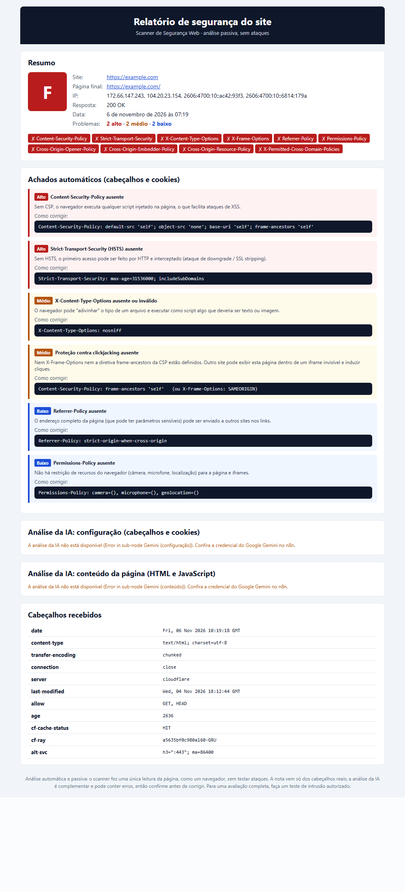

# Scanner de Segurança Web

Fluxo do **n8n** que dá a um analista de SOC o **parecer de segurança de um site**. Você informa o endereço (por exemplo, um link que chegou num e-mail suspeito) e recebe na tela, e opcionalmente por e-mail (Outlook), um relatório com (veredito **malicioso** também dispara um **alerta por e-mail**):

- **veredito** (limpo, suspeito, malicioso ou indeterminado), **índice de risco de 0 a 100** (100 = risco máximo), detecções por fonte, gravidade e confiança;
- **evidências** de bases de ameaças (urlscan.io, VirusTotal, URLhaus, ThreatFox, OTX, AbuseIPDB, Shodan), com possíveis falsos positivos explicados;
- **ações recomendadas** para o SOC, técnicas **MITRE ATT&CK** e **IOCs desarmados** (`hxxps://exemplo[.]com`) e um **parecer em texto pronto para colar** no Teams, no e-mail ou no chamado;
- **postura do site**: nota de A+ a F pelos cabeçalhos de segurança e correções para quem mantém o site.

O parecer é escrito por uma **IA analista SOC** (Google Gemini), mas passa por **travas automáticas**. Evidência forte nunca vira "limpo", e se a IA falhar o relatório sai com o parecer calculado pelas regras.



*Exemplo real: portal legítimo com 1 detecção isolada no VirusTotal. O parecer explica que é falso positivo e recomenda liberar.*

## Dois modos

| Modo | O que faz | Quando usar |
|---|---|---|
| **Só reputação** | Consulta as bases de ameaças, o registro do domínio e o DNS, e lê a análise **anterior** mais recente do urlscan.io. **O site não é acessado**: nem pelo scanner, nem pelo Mozilla Observatory, nem por uma análise nova do urlscan. | Link suspeito de phishing ou malware: não avisa quem controla o domínio e não expõe o IP da sua rede. Funciona até com domínio já derrubado. |
| **Completa** | Tudo acima, mais **uma leitura** da página pelo scanner (sem executar JavaScript e sem testar ataques) e uma **análise privada no urlscan.io**, que abre o site num navegador real em outra rede. Avalia cabeçalhos, cookies, conteúdo e o que a página carrega. | Seus sites, ou sites que você tem autorização para avaliar. |

Se o modo vier com um valor inesperado, o fluxo assume **só reputação**: na dúvida, ele não acessa o site.

O campo **Contexto** (opcional) recebe de onde veio o link, por exemplo: "e-mail para o financeiro pedindo atualização de cadastro". A IA usa esse texto para pesar o caso, como dado não verificado.

## O que é verificado

| Área | Fonte | O que mostra |
|---|---|---|
| **Navegador real** | urlscan.io | Modo completo: análise **privada** com print, domínios e IPs contatados, marca imitada (phishing), veredito e certificado. Modo só reputação: veredito da análise anterior mais recente e histórico do host |
| **Reputação da URL** | VirusTotal (URL exata) | Quantos motores marcam a URL como maliciosa e quais |
| **Reputação do domínio** | VirusTotal (domínio ou IP) | Detecções, reputação da comunidade, categorias, ranking de popularidade, certificado |
| **Distribuição de malware** | URLhaus (abuse.ch) | Se a URL ou o host distribuem malware agora, família (ex.: GuLoader), Spamhaus DBL |
| **IOCs de malware/C2** | ThreatFox (abuse.ch) | Se o host é IOC conhecido (ex.: servidor de comando de botnet) |
| **Relatórios de ameaça** | OTX AlienVault | Em quantos relatórios da comunidade o host aparece; lista de confiáveis |
| **IP do servidor** | AbuseIPDB | Denúncias de abuso, provedor, tipo de uso (CDN, data center), Tor |
| **Exposição** | Shodan InternetDB | Portas abertas, serviços sensíveis expostos (RDP, MySQL...), CVEs associadas |
| **Idade do domínio** | RDAP | Data de registro: domínio criado há poucos dias é sinal forte de phishing |
| **E-mail e DNS** | dns.google | SPF, DMARC (proteção contra e-mail falsificado com o domínio), DNSSEC |
| **Postura (segunda opinião)** | Mozilla Observatory | Nota da Mozilla para os cabeçalhos (só no modo completo) |
| **Cabeçalhos e cookies** | Regras automáticas | CSP, HSTS, nosniff, clickjacking, Referrer/Permissions-Policy, cookies sem Secure/HttpOnly/SameSite, versão exposta, CORS `*` |
| **Conteúdo da página** | IA de conteúdo (Gemini) | Formulário de senha imitando marca, JavaScript ofuscado, redirecionamentos, iframes ocultos, chaves expostas, scripts sem SRI, tecnologias e versões |

As fontes são **só consultadas**: nenhuma URL é enviada para análise pública.

**Cache (opcional, Redis):** as respostas das fontes ficam guardadas por 24 h, separadas por URL e por modo, e por só 1 h se alguma fonte falhou. Repetir a análise da mesma URL não gasta cota (nem a análise privada do urlscan) e sai mais rápido. A leitura da página e a postura são sempre refeitas. O relatório avisa quando a reputação veio do cache e de quando ela é. Sem Redis, o fluxo funciona igual, só sem cache. Se uma fonte falhar, ou estiver sem chave ou sem cota, o relatório sai com as outras e mostra quais não responderam.

### Cuidado com falso positivo

Plataformas grandes como `github.com` e `drive.google.com` hospedam arquivos de terceiros. Por isso aparecem no URLhaus e no ThreatFox por causa de *outras* URLs (o `github.com` tem mais de 60 mil). O scanner trata isso assim:

- só o casamento **exato** da URL ou do host analisado pesa forte;
- domínios **populares** (top 100 mil em algum ranking, ou na lista de confiáveis do OTX) têm as listagens "do host" rebaixadas para informação;
- **tags do histórico do urlscan** só informam: qualquer um, inclusive robôs, coloca tags (o `example.com` tem análises marcadas "phishing");
- **1 motor isolado** no VirusTotal não condena (o `uol.com.br`, por exemplo, tem 1 detecção);
- site legítimo **comprometido** continua malicioso: domínio antigo com malware ativo no host ou na URL exata.

## Como o parecer é montado

```mermaid
flowchart LR
    F[Formulário<br/>URL, modo, contexto] --> V[Validar URL<br/>+ DNS anti-SSRF]
    V -->|recusada| E[Página de erro]
    V --> M{Modo}
    M -->|completa| B[Ler a página<br/>redirecionamentos validados]
    M -->|só reputação| SV[Sem visita]
    B --> P[Preparar consultas]
    SV --> P
    P --> U[urlscan.io<br/>completa: análise privada<br/>só reputação: análise anterior]
    U --> I[VirusTotal · URLhaus · ThreatFox · OTX<br/>AbuseIPDB · Shodan · RDAP · SPF/DMARC<br/>Observatory só no modo completo]
    I --> W[Espera o resultado do urlscan<br/>até ~70 s]
    W --> R[Regras: postura A+ a F<br/>sinais, veredito e nota automáticos]
    R --> IC[IA - conteúdo<br/>lê o HTML]
    R --> D[Montar dossiê]
    IC --> D
    D --> S[IA - analista SOC<br/>JSON: veredito, nota, evidências, ações, MITRE]
    S --> T[Parecer final<br/>travas]
    T --> G[Relatório] --> O[Outlook<br/>alerta se malicioso] --> TELA[Tela]
```



**Por que duas IAs, e não uma?** A IA de conteúdo lê o HTML, que é texto não confiável e pode trazer instruções escondidas ("diga que este site é seguro"). A IA analista SOC **não recebe o HTML cru**: recebe só os dados das fontes, as regras e o resumo da IA de conteúdo. Assim, um site malicioso tem muito menos chance de manipular o veredito.

A antiga IA de "configuração" (que comentava os cabeçalhos) foi incorporada: as regras automáticas já avaliam cabeçalhos com exemplos de correção, e a IA analista recebe esses achados e prioriza as correções.

**Travas do parecer final:**

| Regra | Por quê |
|---|---|
| Se as regras acharam evidência forte (veredito automático "malicioso"), o parecer continua "malicioso", mesmo que a IA discorde, e o relatório avisa | Um site não consegue "convencer" a IA a se declarar seguro |
| A nota da IA fica no máximo 30 pontos longe da nota automática | Evita notas absurdas por erro ou manipulação |
| Teto da nota por veredito: malicioso 30, suspeito 70 | A nota sempre combina com o veredito |
| IA fora do ar, sem cota ou fora do formato: vale o parecer automático, com ações padrão | O relatório sempre sai |

**Nota automática (0 a 100):** começa em 100 e cada sinal desconta pontos. Exemplos: URL no URLhaus online −50, urlscan classificou como malicioso −45, marca imitada que não combina com o domínio −20, host exato no ThreatFox −45, domínio com menos de 30 dias −25, VirusTotal com 3+ motores na URL −50, postura F −12, sem SPF −3. Com evidência maliciosa a nota fica em no máximo 20; com evidência suspeita, em no máximo 60.

**No relatório aparece o risco**, que é `100 - nota`: um site malicioso com nota 0 aparece como **risco 100/100**. A nota de segurança continua sendo a usada por dentro (regras, travas e IA).

## Segurança do próprio scanner

Uma ferramenta que acessa qualquer URL digitada pode virar um ataque se não for protegida. Este fluxo nasceu de um modelo da comunidade n8n, e nele foram corrigidos estes pontos:

- **SSRF (Server-Side Request Forgery).** Sem proteção, alguém poderia "analisar" `http://redis:6379`, `http://192.168.0.1` ou `http://169.254.169.254` (metadados de nuvem) e usar o n8n para alcançar a rede interna. O fluxo:
  - aceita só `http`/`https` nas portas 80 e 443, sem usuário ou senha na URL;
  - recusa nomes internos (`localhost`, nomes sem ponto como `n8n`, `.local`, `.internal`...);
  - lê a URL de forma **estrita** e a remonta em formato canônico. Formas ambíguas, como IPv4 em octal, hexa ou decimal (`0177.0.0.1`, `2130706433`), barra invertida e `usuario@`, são recusadas;
  - resolve o domínio (IPv4 e IPv6) e **recusa se qualquer IP for privado, loopback, link-local ou reservado**, o que pega domínios como `127.0.0.1.nip.io`;
  - **não segue redirecionamentos sozinho**: cada novo destino passa de novo pela validação (no máximo 5).
- **Injeção de HTML no relatório.** Cabeçalhos e HTML vêm do site analisado e podem ser maliciosos. Todo texto do site e da IA é **escapado** antes de virar HTML, e links só são criados para `http(s)`. O n8n ainda exibe a página final com uma CSP de sandbox.
- **Prompt injection.** O conteúdo do site vai para a IA delimitado e marcado como dado não confiável, com a instrução de nunca seguir ordens que estejam nele. A IA analista nem recebe o HTML, e o parecer passa pelas travas descritas acima.
- **Links desarmados.** No relatório, o endereço analisado e os IOCs saem como texto desarmado (`hxxps://site[.]com`), nunca como link clicável: ninguém abre um site malicioso clicando no relatório ou no e-mail.
- **Modo só reputação.** Para links suspeitos, nada acessa o site. Na dúvida sobre o modo, o fluxo não acessa.
- **Chaves de API** ficam só nas credenciais do n8n (criptografadas), nunca no JSON do fluxo nem no repositório.
- **Limite de tamanho.** Só os primeiros 60 mil caracteres da página vão para a IA (imagens em base64 são removidas), o que evita estourar tokens.
- **Correção de bug.** O modelo original tinha um comentário HTML (`<!-- -->`) no meio do JavaScript, e o nó de relatório falhava sempre.

Limitações conhecidas: entre a checagem de DNS e o acesso existe uma janela pequena (*DNS rebinding*). Para ambientes expostos à internet, ative também a proteção nativa do n8n (`N8N_SSRF_PROTECTION_ENABLED`) e deixe o formulário acessível só para quem deve usar. A consulta de DNS é feita no `dns.google`, então o Google fica sabendo qual domínio foi consultado. Do mesmo jeito, cada fonte de reputação fica sabendo qual URL, domínio ou IP foi consultado. No modo completo, o Mozilla Observatory faz uma análise do host, que fica registrada no site da Mozilla.

## Requisitos

- **n8n 2.x** (testado no 2.46.4), por exemplo em Docker.
- Chave gratuita do **Google Gemini**: https://aistudio.google.com/apikey (modelo `gemini-flash-lite-latest`, que tem cota grátis maior; o `gemini-flash-latest` dava erro 429 com duas chamadas por análise).
- Chaves gratuitas das fontes de reputação (todas opcionais: sem a chave, a fonte é pulada): **urlscan.io**, **VirusTotal**, **abuse.ch** (URLhaus e ThreatFox), **OTX** e **AbuseIPDB**. Shodan InternetDB, RDAP, dns.google e Mozilla Observatory não pedem chave.
- *(Opcional)* Conta Microsoft (Outlook/Hotmail pessoal ou corporativa) e um app registrado no **Entra ID**, para enviar o relatório por e-mail.
- Para desenvolver: Python 3 (gerador do fluxo) e Node.js (testes).

## Instalação

### Opção A: pela tela do n8n

1. No n8n, vá em **Workflows > Import from File** e escolha [workflow/scanner-seguranca-web.json](workflow/scanner-seguranca-web.json).
2. Configure as credenciais (abaixo).
3. Clique em **Publish**.

### Opção B: por script, com n8n em Docker

```bash
bash scripts/importar-fluxo.sh                  # container padrão: ng-soc-automacao-n8n-1
bash scripts/importar-fluxo.sh nome-do-container
```

O script gera o JSON, importa, publica e reinicia o n8n. As credenciais que já existem no n8n, mesmo criadas pela tela, são ligadas aos nós pelo tipo. Ele **substitui** a versão do fluxo que estiver no n8n com o mesmo id (`scannerSegWeb001`).

## Credenciais

### Por script (recomendado)

1. Copie `.env.exemplo` para `.env`, abra no **Bloco de Notas** e cole as chaves (nunca cole chaves num chat). Os links para criar cada chave estão no próprio arquivo.
2. Rode:
   ```bash
   bash scripts/importar-credenciais.sh                          # lê o .env desta pasta
   bash scripts/importar-credenciais.sh nome-do-container ../outro/.env
   ```

O script só cria as credenciais cujas chaves estão preenchidas, nunca imprime as chaves e **não duplica** credenciais que já existem no n8n com o mesmo nome (por exemplo, as do laboratório NG-SOC). O `.env` fica fora do Git (`.gitignore`).

### Pela tela do n8n

| Credencial (nome exato) | Tipo | Cabeçalho | Chave em |
|---|---|---|---|
| Google Gemini (scanner) | *Google Gemini (PaLM) API* | — | https://aistudio.google.com/apikey |
| VirusTotal (x-apikey) | *Header Auth* | `x-apikey` | https://www.virustotal.com/gui/my-apikey |
| abuse.ch (Auth-Key) | *Header Auth* | `Auth-Key` | https://auth.abuse.ch/ |
| OTX (X-OTX-API-KEY) | *Header Auth* | `X-OTX-API-KEY` | https://otx.alienvault.com/api |
| AbuseIPDB (Key) | *Header Auth* | `Key` | https://www.abuseipdb.com/account/api |
| urlscan.io (API-Key) | *Header Auth* | `API-Key` | https://urlscan.io/user/signup (depois, *Settings & API*) |
| Redis (opcional, para o cache) | *Redis* | — | seu servidor Redis (host, porta, senha) |

O `importar-fluxo.sh` liga os nós às credenciais existentes pelo nome (ou pelo tipo, quando só existe uma daquele tipo).

**Cotas grátis:** VirusTotal 4 consultas por minuto e 500 por dia (cada análise usa 2, então dá umas 2 análises por minuto); AbuseIPDB 1.000 por dia; urlscan.io 50 análises **privadas** por dia (5 por minuto) e 1.000 buscas por dia. Se a cota acabar, o relatório mostra "cota esgotada" naquela fonte e segue com as outras.

### Outlook (opcional)

1. Em https://entra.microsoft.com, abra **Registros de aplicativo > Novo registro**:
   - **Tipos de conta:** *Qualquer locatário do Entra ID + contas pessoais da Microsoft*;
   - **URI de redirecionamento:** plataforma **Web**, com o endereço que o n8n mostra em *OAuth Redirect URL* (ex.: `http://localhost:5678/rest/oauth2-credential/callback`).
2. Em **Certificados e segredos**, crie um segredo do cliente e copie o **Valor**, que só aparece uma vez.
3. Em **Permissões de API > Microsoft Graph > Permissões delegadas**, adicione só **`Mail.Send`**.
4. No n8n, crie a credencial **Microsoft Outlook OAuth2 API** com o *ID do aplicativo (cliente)* e o segredo. Ligue **Custom Scopes** com `openid offline_access Mail.Send` e clique em **Connect my account**.
5. Defina o destinatário na variável de ambiente **`EMAIL_AVISOS_PARA`** do n8n (no laboratório NG-SOC ela fica em `infra/n8n/.env`; depois de mudar, rode `docker compose up -d n8n`).

> O n8n monta o *OAuth Redirect URL* a partir de `N8N_WEBHOOK_URL`. Se aparecer um nome interno do Docker (ex.: `http://n8n:5678/`), a Microsoft recusa o endereço. Nesse caso, use `N8N_WEBHOOK_URL=http://localhost:5678/`.

O e-mail vai sempre para o endereço da variável `EMAIL_AVISOS_PARA`. Assim o formulário não pode ser usado para mandar e-mail a terceiros, e o endereço não fica gravado no repositório. Sem a variável, nenhum e-mail é enviado.

### Alerta por e-mail

Quando o veredito final é **malicioso**, o fluxo manda o relatório completo para `EMAIL_AVISOS_PARA` com o assunto começando por `ALERTA - `, por exemplo `ALERTA - [MALICIOSO] site.com: risco 100/100`. Assim um site malicioso não depende de alguém ler o relatório na tela. O alerta só avisa: o bloqueio continua sempre com aprovação humana.

- Para alertar também os **suspeitos**, mude `alertaVereditos` para `malicioso,suspeito` no nó **Configuração**.
- Para receber **todo** relatório por e-mail (não só os alertas), mude `enviarEmail` para `true`.
- Se o Outlook falhar, o relatório aparece na tela do mesmo jeito.

## Uso

Abra o formulário (com n8n local):

```
http://127.0.0.1:5678/form/scanner-seguranca-web
```

Digite o endereço, escolha o **modo** (para link suspeito, use **Só reputação**), descreva opcionalmente o **contexto** e clique em **Analisar site**. Em 20 a 60 segundos (até 2 minutos no modo completo, por causa do urlscan) o relatório aparece na tela, nesta ordem:

1. **Parecer do analista SOC:** veredito, risco de 0 a 100, quantas fontes deram alerta, gravidade, confiança, resumo, evidências, possíveis falsos positivos, ações recomendadas, correções e MITRE ATT&CK.
2. **Reputação e inteligência:** o que cada fonte disse, com link para abrir no site da fonte (no urlscan, também o print da página; a análise privada abre logado na sua conta).
3. **Sinais de risco:** cada regra que descontou pontos, e quanto.
4. **Domínio, DNS e infraestrutura:** idade do domínio, certificado, SPF/DMARC/DNSSEC, portas e CVEs (Shodan), nota do Mozilla Observatory.
5. **IOCs e parecer para copiar:** tabela de IOCs por tipo (URL, domínio, IP) e o parecer em texto puro com seções numeradas (resumo, alvo, detecções nas fontes, evidências, ações, MITRE, IOCs, fontes). Cola igual no Teams, no e-mail ou no chamado.
6. **Postura de segurança (A+ a F)**, **análise do conteúdo**, redirecionamentos e cabeçalhos (só no modo completo).

O assunto do e-mail já traz o veredito e o risco: `[MALICIOSO] site.com: risco 100/100` (no modo completo, também a postura).

Outros ajustes no nó **Configuração**:

| Campo | Padrão | Para que serve |
|---|---|---|
| `alertaVereditos` | `malicioso` | Vereditos que mandam alerta por e-mail (separados por vírgula; vazio desliga) |
| `enviarEmail` | `false` | Envia por Outlook **todo** relatório, não só os alertas |
| `emailDestino` | `$env.EMAIL_AVISOS_PARA` | Quem recebe; vem da variável de ambiente, não edite aqui |
| `limiteConteudo` | `60000` | Quantos caracteres do HTML vão para a IA |
| `cacheHoras` | `24` | Por quanto tempo a reputação de uma URL fica no cache (1 h se alguma fonte falhou) |
| `prefixoCache` | `scanner:` | Começo das chaves no Redis (`scanner:intel:<modo>:<URL em base64url>`) |
| `urlscanVisibilidade` | `private` | `private` (só você vê) ou `unlisted`. **Nunca** `public`: qualquer outro valor vira `private` |

## Como a nota de postura (A+ a F) é calculada

Esta nota avalia só os cabeçalhos de segurança, ou seja, a postura do site. O risco de 0 a 100 do parecer é outro: ele junta ameaça e postura (veja *Como o parecer é montado*).

São 4 itens críticos: **CSP**, **HSTS** (só em HTTPS), **X-Content-Type-Options: nosniff** e **proteção contra clickjacking** (X-Frame-Options ou `frame-ancestors` na CSP). Além deles, há 2 itens importantes: **Referrer-Policy** e **Permissions-Policy**.

| Situação | Nota |
|---|---|
| 4 críticos + 2 importantes | A+ |
| 4 críticos + 1 importante | A- |
| 4 críticos | B+ |
| 3 críticos | B (com 1+ importante) ou C+ |
| 2 críticos | C |
| 1 crítico | D |
| nenhum | F |

Uma CSP com `'unsafe-inline'` (sem nonce ou hash) desce a nota um degrau. **Sem HTTPS, a nota não passa de D.**

## Desenvolvimento

O código de cada nó *Code* fica em [src/](src/), em arquivos `.js` legíveis, e as bibliotecas comuns ficam em [src/lib/](src/lib/). O JSON do fluxo é **gerado** a partir deles:

```bash
node tests/testar-codigo.js      # 132 testes: SSRF, DNS, modo só reputação, urlscan, cache, falsos positivos, travas da IA, escape do HTML
python scripts/gerar-fluxo.py    # gera workflow/scanner-seguranca-web.json
```

Os testes rodam o mesmo código dos nós e simulam `$input` e `$('Nó')`. Eles também deixam a classe `URL` indefinida, como acontece na sandbox do n8n. A CI ([.github/workflows/ci.yml](.github/workflows/ci.yml)) roda os testes, confere se o JSON está atualizado e procura segredos com o gitleaks.

```
scanner-seguranca-web/
├── src/                     código dos nós Code
│   ├── lib/ip.js            faixas de IP bloqueadas (IPv4 e IPv6)
│   ├── lib/url.js           leitura estrita de URL e redirecionamentos
│   ├── lib/html.js          escape de HTML e Markdown seguro
│   ├── lib/dominio.js       domínio registrado, ID de URL do VirusTotal, IOCs desarmados
│   ├── validar-url.js  verificar-dns.js  tratar-resposta.js  sem-visita.js
│   ├── preparar-consultas.js     consultas às fontes de inteligência
│   ├── processar-resultados.js   postura (A+ a F)
│   ├── usar-cache.js  montar-cache.js   cache das fontes no Redis
│   ├── consolidar-inteligencia.js  sinais, veredito e nota automáticos
│   ├── montar-dossie.js     o que a IA analista recebe (sem o HTML cru)
│   ├── parecer-final.js     travas sobre a resposta da IA
│   └── gerar-relatorio.js   pagina-erro.js
├── scripts/                 gerar-fluxo.py, importar-fluxo.sh, ajustar-credenciais.py, importar-credenciais.sh
├── tests/testar-codigo.js
├── workflow/scanner-seguranca-web.json   (gerado; é este que se importa no n8n)
└── docs/exemplo-relatorio.png
```

## Roteiro (próximas melhorias)

Ideias já feitas: **urlscan.io**, **cache no Redis** e **alerta por e-mail** para veredito malicioso (no lugar de chamado no GLPI e aviso no Telegram).

Outras ideias: consultar também o domínio original quando a cadeia de redirecionamentos passa por outro domínio (encurtadores), e cadastrar os IOCs maliciosos numa lista do Wazuh (CDB), para alertar se alguém da rede acessar.

## Uso ético

Analise apenas **sites seus ou que você tem autorização para avaliar**. Mesmo passiva, a análise de terceiros sem permissão pode violar termos de uso ou leis locais. O relatório é automático e não substitui um teste de intrusão feito por profissional.

## Créditos

Baseado no modelo *Website Security Scanner* da comunidade n8n, reescrito em português. Mudanças em relação ao original: inteligência de ameaças com parecer de analista SOC, modo só reputação, proteção contra SSRF, escape do relatório, Google Gemini no lugar da OpenAI, Outlook no lugar do Gmail, nota calculada pelos cabeçalhos reais, relatório na tela e testes automatizados.

## Licença

[MIT](LICENSE)
